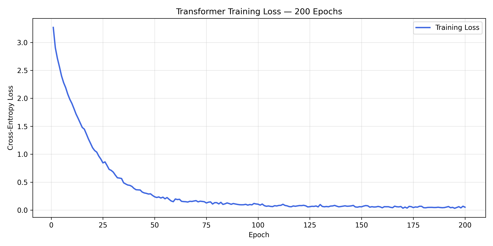

# LingoUz — English-to-Uzbek Transformer

A character-level English-to-Uzbek word translation
model trained from scratch using PyTorch, inspired
by the paper "Attention Is All You Need" (2017).

## Tech Stack

Python · PyTorch · NLP · Transformers · Streamlit

## Model Architecture

| Parameter | Value |
|---|---|
| Architecture | Encoder-Decoder Transformer |
| Tokenization | Character-level |
| Embedding Dimension | 64 |
| Attention Heads | 4 |
| Encoder Layers | 2 |
| Decoder Layers | 2 |
| Feed-Forward Dimension | 128 |
| Dropout | 0.1 |

## Dataset

The model was trained on 100 English-Uzbek word pairs
without using pretrained models or translation APIs.

## Training Results

| Parameter | Value |
|---|---|
| Epochs | 200 |
| Batch Size | 16 |
| Learning Rate | 0.001 |
| Optimizer | Adam |
| Loss Function | Cross-Entropy |
| Final Training Loss | 0.0520 |



## Installation

```bash
git clone https://github.com/OrastaRakhmatullayeva/english-uzbek-transformer.git
cd english-uzbek-transformer
pip install -r requirements.txt
```

## Run the Application

```bash
streamlit run app.py
```

## Train the Model

```bash
python train.py --epochs 200
```

## Evaluation

```bash
python evaluate.py
```

## Limitations

This is an educational word-level translation model.
Its small dataset limits generalization to unseen
words and sentences.

## Reference

Vaswani et al. (2017).
[Attention Is All You Need](https://arxiv.org/abs/1706.03762).

## Author

Orasta Rakhmatullayeva
